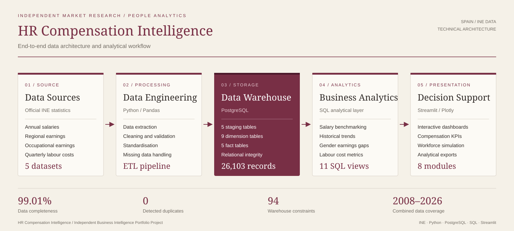

# HR Compensation Intelligence

### Spanish Labour Market & Workforce Analytics Platform

**Business Intelligence · Data Engineering · People Analytics**

An end-to-end analytics platform designed to explore compensation
structures, salary trends, regional differences, occupational
earnings and workforce costs across Spain.

Developed using official statistics from the Spanish National
Statistics Institute (INE), the platform integrates Python,
PostgreSQL, advanced SQL analytics and interactive visualisation
to support evidence-based compensation and workforce decisions.

---

## Live Application

**[Explore HR Compensation Intelligence](https://hr-compensation-intelligence.streamlit.app/)**

The platform is publicly available through Streamlit Community
Cloud, providing access to eight interactive analytical modules,
historical salary benchmarks and workforce cost simulations.

No installation or database configuration is required to explore
the public dashboard.

The deployed application uses analytical data snapshots exported
from PostgreSQL, while the local architecture supports direct
database connectivity.

---

## Technology Stack

---

## 01 / Project Overview

Compensation management plays a strategic role in talent
attraction, employee retention, workforce planning and
organisational competitiveness.

HR Compensation Intelligence transforms official labour market
statistics into a structured analytical environment where users
can explore compensation patterns and evaluate workforce costs.

The platform is designed to support:

- Compensation and salary benchmarking.
- Regional labour market analysis.
- Industry and occupational comparisons.
- Gender earnings gap analysis.
- Workforce budget planning.
- Historical compensation research.
- Strategic Human Resources decision-making.

This is an independent Business Intelligence and People
Analytics portfolio project focused on the practical
application of data engineering and business analytics.

---

## 02 / Project at a Glance

| Project indicator | Value |
|---|---:|
| Official INE datasets | 5 |
| Statistical records | 26,103 |
| PostgreSQL schemas | 3 functional schemas |
| Staging tables | 5 |
| Dimension tables | 9 |
| Fact tables | 5 |
| Analytical SQL views | 11 |
| Database constraints | 94 |
| Interactive analytical modules | 8 |
| Data completeness | 99.01% |
| Detected duplicate records | 0 |
| Combined historical coverage | 2008–2026 |

---

## 03 / Executive Market Findings

### Spain — Annual Compensation, 2024

| Market indicator | Value |
|---|---:|
| National average annual salary | €29,540.26 |
| Previous year average salary | €28,049.94 |
| Annual salary increase | €1,490.32 |
| Year-on-year salary growth | 5.31% |
| Average male annual salary | €32,057.55 |
| Average female annual salary | €26,904.90 |
| Annual gender earnings difference | €5,152.65 |
| Unadjusted annual earnings gap | 16.07% |

The national average annual salary increased by 5.31% in 2024,
reflecting continued nominal compensation growth compared
with the previous year.

Differences in reported annual earnings highlight the
importance of analysing compensation across geographic,
economic and occupational categories.

These indicators represent aggregated statistical observations
rather than individual salary predictions.

---

## 04 / Analytical Modules

### Executive Overview

National compensation indicators, historical salary evolution,
annual growth and executive market insights.

### Regional Benchmarking

Geographic salary comparisons, regional compensation rankings,
interactive maps and national benchmark comparisons.

### Sector Intelligence

Salary structures across economic activities, sector rankings
and historical compensation trends.

### Occupational Intelligence

Compensation differences across occupational categories
and historical earnings comparisons.

### Gender Pay Gap

Analysis of unadjusted annual earnings differences between
men and women across available statistical categories.

### Labour Cost Intelligence

Quarterly labour cost analysis, salary costs, non-salary
costs and historical cost evolution.

### Workforce Cost Simulator

Interactive workforce planning scenarios based on salary
benchmarks, employee numbers and estimated additional costs.

### Data & Methodology

Official data sources, analytical definitions, database
architecture, data quality and methodological limitations.

---

## 05 / Technical Architecture

The platform follows a layered Business Intelligence
architecture that separates data preparation, relational
storage, analytical logic and presentation.

### Architecture Layers

| Layer | Technology | Purpose |
|---|---|---|
| Data Sources | INE | Official statistical observations |
| Data Engineering | Python / Pandas | Cleaning and standardisation |
| Staging | PostgreSQL | Structured data ingestion |
| Data Warehouse | PostgreSQL | Dimensional data modelling |
| Analytics | SQL | Business metrics and benchmarking |
| Data Access | SQLAlchemy | Database connectivity |
| Presentation | Streamlit / Plotly | Interactive analytics |

The architecture provides a structured foundation for
maintainability, reproducibility and future expansion.

---

## 06 / Data Engineering

Python and Pandas are used to transform official statistical
datasets into structured analytical data.

The ETL workflow includes:

- Source dataset exploration.
- CSV ingestion.
- Data cleaning.
- Numerical format conversion.
- Data type standardisation.
- Missing value identification.
- Statistical quality flag handling.
- Data validation.
- PostgreSQL ingestion.

Raw datasets are maintained separately from processed
datasets to preserve source traceability.

Missing statistical observations are preserved rather
than automatically replaced with zero.

---

## 07 / PostgreSQL Data Warehouse

The relational database is organised into three
functional schemas.

| Schema | Objects | Purpose |
|---|---:|---|
| staging | 5 tables | Source data ingestion |
| warehouse | 14 tables | Dimensional data model |
| analytics | 11 views | Business intelligence calculations |

### Dimension Tables

The warehouse contains nine dimension tables:

- dim_cost_component
- dim_economic_activity
- dim_gender
- dim_national_occupation
- dim_quarter
- dim_region
- dim_regional_occupation
- dim_sector
- dim_year

### Fact Tables

| Fact table | Records |
|---|---:|
| fact_labour_costs | 16,872 |
| fact_salary_economic_activity | 969 |
| fact_salary_occupation | 918 |
| fact_salary_regional_occupation | 3,672 |
| fact_salary_regional_sector | 3,672 |
| **Total** | **26,103** |

The dimensional model separates descriptive business
attributes from quantitative statistical observations.

Annual salary statistics and quarterly labour costs
are maintained at their respective analytical granularities.

### Database Integrity

| Constraint type | Count |
|---|---:|
| Primary keys | 14 |
| Foreign keys | 18 |
| Unique constraints | 9 |
| Check constraints | 53 |
| **Total** | **94** |

Database constraints support relational integrity,
consistency and structured analytical processing.

---

## 08 / SQL Analytics

The analytical layer consists of eleven PostgreSQL views
that transform warehouse observations into business-oriented
compensation indicators.

The SQL layer supports:

- National salary benchmarking.
- Historical salary evolution.
- Year-on-year growth calculations.
- Regional compensation comparisons.
- Economic activity analysis.
- Occupational salary analysis.
- Gender earnings differences.
- Labour cost metrics.
- Salary benchmark indices.

Analytical views provide a reusable interface between
the relational warehouse and the Streamlit application.

---

## 09 / Data Quality & Validation

Data quality checks were performed directly against
the PostgreSQL warehouse.

| Dataset | Records | Non-null | Missing |
|---|---:|---:|---:|
| Labour costs | 16,872 | 16,872 | 0 |
| Salary by economic activity | 969 | 969 | 0 |
| Salary by occupation | 918 | 856 | 62 |
| Regional salary by occupation | 3,672 | 3,672 | 0 |
| Regional salary by sector | 3,672 | 3,476 | 196 |
| **Total** | **26,103** | **25,845** | **258** |

### Validation Results

| Quality indicator | Result |
|---|---:|
| Data completeness | 99.01% |
| Missing numerical observations | 258 |
| Detected duplicate records | 0 |
| Warehouse integrity constraints | 94 |

Completeness measures the proportion of non-null numerical
observations and does not imply that every observation
is free from statistical uncertainty.

---

## 10 / Analytical Methodology

### Average Annual Salary

Reported mean annual gross earnings for the selected
statistical category.

### Year-on-Year Salary Growth

    ((Current Salary / Previous Salary) - 1) × 100

Measures nominal annual compensation growth.

### Unadjusted Gender Earnings Gap

    ((Male Salary - Female Salary) / Male Salary) × 100

Measures relative differences in reported average
annual earnings.

### Salary Benchmark Index

    (Category Salary / National Salary) × 100

- Above 100: salary above the national benchmark.
- Below 100: salary below the national benchmark.
- Equal to 100: salary equal to the national benchmark.

### Non-Salary Cost Ratio

    (Non-Salary Cost / Salary Cost) × 100

Measures non-salary labour costs relative to salary costs.

### Estimated Workforce Budget

    Gross Salary Budget + Estimated Additional Costs

Provides illustrative estimates for workforce planning
and compensation budget scenarios.

---

## 11 / Official Data Sources

All statistical source datasets originate from the
Spanish National Statistics Institute (INE).

| Dataset | Statistical domain | Official source |
|---|---|---|
| 6032 | Labour costs by economic activity | [INE Dataset](https://www.ine.es/jaxiT3/Tabla.htm?t=6032) |
| 28185 | Annual salaries by economic activity and gender | [INE Dataset](https://www.ine.es/jaxiT3/Tabla.htm?t=28185) |
| 28186 | Annual salaries by occupation and gender | [INE Dataset](https://www.ine.es/jaxiT3/Tabla.htm?t=28186) |
| 28192 | Regional salaries by sector and gender | [INE Dataset](https://www.ine.es/jaxiT3/Tabla.htm?t=28192) |
| 28193 | Regional salaries by occupation and gender | [INE Dataset](https://www.ine.es/jaxiT3/Tabla.htm?t=28193) |

**Source institution:** [Instituto Nacional de Estadística](https://www.ine.es/)

### Historical Coverage

- Annual salary statistics: 2008–2024.
- Combined historical coverage: 2008–2026.
- Labour cost statistics: quarterly observations.

Salary and labour cost datasets have different reporting
frequencies and publication schedules.

---

## 12 / Repository Structure

    HR-Compensation-Intelligence/
    |
    |-- assets/
    |   |-- architecture.svg
    |
    |-- dashboard/
    |   |-- app.py
    |   |-- database.py
    |
    |-- data/
    |   |-- raw/
    |   |-- processed/
    |
    |-- documentation/
    |   |-- architecture.md
    |   |-- data_dictionary.md
    |   |-- data_quality.md
    |   |-- methodology.md
    |   |-- data_exploration_report.txt
    |
    |-- python/
    |
    |-- sql/
    |
    |-- .streamlit/
    |-- .gitignore
    |-- README.md

---

## 13 / Local Installation

### Prerequisites

- Python
- PostgreSQL
- Git
- Configured PostgreSQL database

### Clone the Repository

    git clone https://github.com/EmigdioLuque/HR-Compensation-Intelligence.git

    cd HR-Compensation-Intelligence

### Create a Virtual Environment

    python3 -m venv .venv

    source .venv/bin/activate

### Install Dependencies

Install the Python dependencies required by the application.

### Database Configuration

Configure the PostgreSQL connection using local
environment variables.

Execute the data preparation and SQL scripts in their
required dependency order to initialise the staging,
warehouse and analytics schemas.

Database credentials must never be committed to
the public repository.

### Launch the Application

    python -m streamlit run dashboard/app.py

Open the local address displayed by Streamlit
to access the analytical platform.

---

## 14 / Technical Documentation

Detailed technical documentation is available
within the repository.

| Document | Description |
|---|---|
| [System Architecture](documentation/architecture.md) | Technical architecture and data workflow |
| [Data Dictionary](documentation/data_dictionary.md) | Database structure and analytical variables |
| [Data Quality](documentation/data_quality.md) | Validation procedures and quality indicators |
| [Methodology](documentation/methodology.md) | Analytical definitions and limitations |

---

## 15 / Methodological Limitations

- Salary indicators represent aggregated statistical observations.
- Nominal salary changes are not adjusted for inflation.
- Gender earnings gaps are unadjusted annual earnings differences.
- Missing observations may limit specific comparisons.
- Some observations may carry statistical quality flags.
- Annual salary and quarterly labour cost series are analysed separately.
- Workforce simulations are illustrative planning estimates.
- Statistical benchmarks do not represent individual salary recommendations.

---

## 16 / Professional Competencies

This project demonstrates the integration of technical
and business-oriented analytical competencies.

### Data Engineering

- ETL pipeline development.
- Data cleaning and transformation.
- Data quality management.
- Structured database ingestion.

### Database Engineering

- PostgreSQL.
- Relational database design.
- Dimensional data modelling.
- Data warehousing.
- Database integrity.
- SQL analytical views.

### Business Analytics

- Compensation benchmarking.
- People Analytics.
- Labour market research.
- Workforce cost planning.
- Business performance indicators.

### Data Visualisation

- Interactive dashboards.
- Geographic visualisation.
- Historical trend analysis.
- Executive reporting.
- Decision-support applications.

---

## Author

**Emigdio Luque Palomino**

Business Intelligence & Data Analytics Student

CEU San Pablo University — Madrid, Spain

Business Intelligence · Data Analytics · Data Engineering ·
Artificial Intelligence · Business Strategy

---

**HR Compensation Intelligence**

Independent Business Intelligence & People Analytics Project.

Developed using official Spanish labour market statistics.

INE · Python · PostgreSQL · SQL · Streamlit · Plotly
