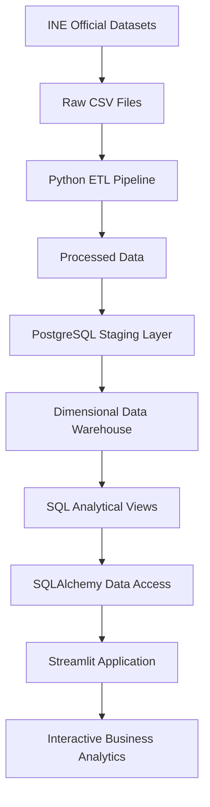

# Technical Architecture

## 1. Project Overview

HR Compensation Intelligence is an independent Business Intelligence
and People Analytics platform designed to analyse compensation,
salary trends and workforce costs across the Spanish labour market.

The project integrates official statistical data, Python-based data
processing, a PostgreSQL data warehouse, SQL analytical views and
an interactive Streamlit application.

## 2. Architecture Overview

## 3. Technology Stack

| Technology | Purpose |
|---|---|
| Python | Data processing and application development |
| Pandas | Data cleaning and transformation |
| PostgreSQL | Relational database management |
| SQL | Data modelling and analytical calculations |
| SQLAlchemy | Database connectivity |
| Streamlit | Interactive analytical application |
| Plotly | Interactive data visualisation |
| Git | Version control |
| GitHub | Source code distribution |
| INE | Official statistical data provider |

## 4. Data Architecture

The database is organised into three logical schemas.

### Staging Layer

Schema: `staging`

The staging layer stores structured source data before its
integration into the dimensional data warehouse.

- 5 staging tables
- Standardised data structures
- Intermediate data ingestion layer

### Data Warehouse

Schema: `warehouse`

The warehouse follows a dimensional modelling approach,
separating descriptive attributes from quantitative observations.

- 9 dimension tables
- 5 fact tables
- 26,103 fact records
- Primary and foreign key relationships
- Data integrity constraints

### Analytical Layer

Schema: `analytics`

The analytical layer contains 11 SQL views that expose
business-oriented metrics and benchmarking indicators.

Analytical domains include:

- National salary evolution
- Regional salary benchmarking
- Economic activity analysis
- Occupational compensation
- Gender pay gap analysis
- Labour cost intelligence

## 5. Application Architecture

The presentation layer consists of eight interactive modules:

1. Executive Overview
2. Regional Benchmarking
3. Sector Intelligence
4. Occupational Intelligence
5. Gender Pay Gap
6. Labour Cost Intelligence
7. Workforce Cost Simulator
8. Data & Methodology

The application retrieves analytical data from PostgreSQL
and presents it through interactive charts, tables, filters
and key performance indicators.

## 6. Security and Configuration

Database credentials are maintained separately from the
application source code.

Sensitive configuration files must not be included
in the public repository.

Public deployment requires a securely configured database
connection and appropriate database access permissions.

## 7. Architectural Objectives

- Separation of data ingestion, storage and presentation.
- Consistent analytical definitions.
- Reusable SQL business logic.
- Traceable statistical observations.
- Maintainable application structure.
- Support for future dataset updates.

## 8. Project Scope

This architecture was developed as an independent portfolio
project demonstrating an end-to-end analytical workflow.

It is not intended to operate as a production payroll system
or an enterprise human resources information system.